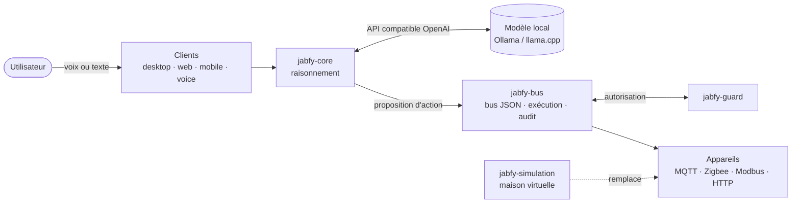

# Jabfy — Just A Butler For You

Jabfy est un assistant domestique **100 % local** : il comprend une demande, propose une action, la fait vérifier de façon déterministe, puis l'exécute sur les appareils de la maison. Aucune donnée ne quitte le réseau local, et chaque décision est tracée.

Ce site rassemble la documentation transverse de l'EIP : vision, veille, architecture globale, objectifs et comptes-rendus de suivi. La documentation technique de chaque composant vit dans son repo et est recopiée automatiquement dans [Composants](composants/README.md).

## Schéma global

L'IA propose, Guard autorise, le Bus exécute. Le détail est dans [Architecture](architecture/README.md).

## Repos

| Repo | Rôle | Visibilité |
|---|---|---|
| [jabfy-core](https://github.com/jabfy-corp/jabfy-core) | Moteur d'orchestration : API FastAPI, propositions du modèle, validation | Public |
| [jabfy-bus](https://github.com/jabfy-corp/jabfy-bus) | Bus JSON universel : adapters de protocoles, vérification, exécution, audit | Privé |
| [jabfy-guard](https://github.com/jabfy-corp/jabfy-guard) | Bibliothèque d'autorisation déterministe des commandes | Public |
| [jabfy-simulation](https://github.com/jabfy-corp/jabfy-simulation) | Maison virtuelle 3D parlant MQTT au format Zigbee2MQTT | Privé |
| [jabfy-deploy](https://github.com/jabfy-corp/jabfy-deploy) | Assemblage, démarrage et topologie de la stack | Privé |
| [jabfy-voice](https://github.com/jabfy-corp/jabfy-voice) | Micro, STT, réponse du modèle, synthèse vocale | Public |
| [jabfy-tts](https://github.com/jabfy-corp/jabfy-tts) | Paquet npm de synthèse vocale (Kokoro-82M) | Public |
| [jabfy-desktop](https://github.com/jabfy-corp/jabfy-desktop) | Client Electron + React | Public |
| [jabfy-web](https://github.com/jabfy-corp/jabfy-web) | Client web React | Public |
| [jabfy-mobile](https://github.com/jabfy-corp/jabfy-mobile) | Client React Native / Expo | Public |
| [jabfy-website](https://github.com/jabfy-corp/jabfy-website) | Site vitrine | Privé |
| [jabfy-prototype](https://github.com/jabfy-corp/jabfy-prototype) | Premier prototype Electron + FastAPI + Ollama | Public |
| [jabfy-template](https://github.com/jabfy-corp/jabfy-template) | Squelette de tout nouveau repo | Public |

## Où trouver quoi

| Section | Contenu |
|---|---|
| [Projet](projet/README.md) | Vision, équipe, roadmap et jalons |
| [Veille](veille/README.md) | Objectif obligatoire 1 : une page par problème dur |
| [Architecture](architecture/README.md) | Objectif obligatoire 2 : C4, flux, interfaces, CI/CD, ADR |
| [Composants](composants/README.md) | Doc technique recopiée depuis chaque repo |
| [Protection](protection/README.md) | Objectif complémentaire A : licences, marque, PI, sécurité, RGPD |
| [Performance](performance/README.md) | Objectif complémentaire D : métriques et benchmarks |
| [Contribuer](contribuer/README.md) | Conventions Git et écriture de la doc |
| [Suivi](suivi/README.md) | Comptes-rendus des RDV de suivi |

> Une page de [Composants](composants/README.md) se modifie **dans son repo d'origine**, jamais dans GitBook : la synchronisation suivante écraserait la modification.
