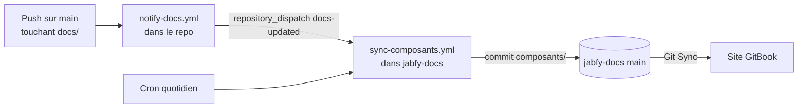

# CI/CD

## Principe

Les workflows communs (lint, tests, build, vérification des liens de la doc) sont centralisés dans le repo [`jabfy-corp/.github`](https://github.com/jabfy-corp/.github) sous forme de **workflows réutilisables**, et chaque repo les appelle :

```yaml
jobs:
  ci:
    uses: jabfy-corp/.github/.github/workflows/python-ci.yml@main
```

Une correction faite une fois dans `.github` profite à tous les repos, et cette page suffit à tout décrire.

## Workflows communs à tous les repos

Fournis par [jabfy-template](https://github.com/jabfy-corp/jabfy-template) :

| Workflow | Déclencheur | Rôle |
|---|---|---|
| `pr-validation.yml` | Pull request | Refuse une PR qui n'est liée à aucune issue (`Closes #N`) |
| `issue-labeler.yml` | Issue ouverte ou modifiée | Pose les labels selon les cases cochées dans l'issue |
| `notify-docs.yml` | Push sur `main` touchant `docs/` | Demande à jabfy-docs de resynchroniser les [composants](../composants/README.md) |

## Workflows par repo

État au 24/10/2026.

| Repo | CI | Livraison |
|---|---|---|
| jabfy-bus | `ci.yml` | `publish-image.yml` : image OCI sur `ghcr.io/jabfy-corp/jabfy-bus` |
| jabfy-core | `ci.yml` | `publish-image.yml` : image OCI sur GHCR |
| jabfy-guard | `tests.yml` | |
| jabfy-simulation | `ci.yml` | |
| jabfy-deploy | `ci.yml` | `update-image-digest.yml` : met à jour le digest des images déployées |
| jabfy-tts | `ci.yml` | `publish.yml` : paquet npm sur GitHub Packages |
| jabfy-website | `ci.yml` | |
| jabfy-docs | `check-docs.yml` (liens internes) | `sync-composants.yml`, puis GitBook Git Sync |

## Pipeline de la documentation



Secrets nécessaires, au niveau de l'organisation :

| Secret | Utilisé par | Droits |
|---|---|---|
| `DOCS_SYNC_TOKEN` | `sync-composants.yml` | PAT fine-grained, *Contents: read* sur les repos listés dans `composants.txt` |
| `DOCS_DISPATCH_TOKEN` | `notify-docs.yml` | PAT fine-grained, *Contents: read and write* sur jabfy-docs |

## À faire

- [ ] Créer les workflows réutilisables `python-ci.yml`, `node-ci.yml` et `docs-links.yml` dans `.github`.
- [ ] Faire appeler ces workflows par chaque repo, à la place des copies locales.
- [ ] Lancer les benchmarks de [Performance](../performance/README.md) en CI avec jabfy-simulation.
