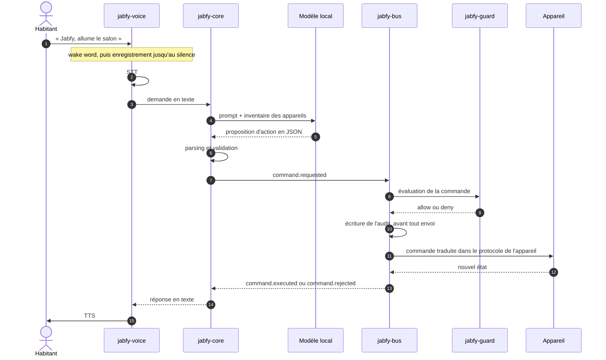

# Flux d'une demande

## Cible : du wake word à la réponse vocale

La voix est hors du périmètre de la V0.0.1 : ce flux est la cible.

## Étapes mesurées

Chaque étape a un chronomètre, pour pouvoir dire où part le temps. Les mesures sont décrites dans [Performance › Latence](../performance/latence.md).

| Étape | Composant | Mesure |
|---|---|---|
| Détection du wake word | jabfy-voice | `t_wake` |
| Fin de parole → texte | jabfy-voice | `t_stt` |
| Demande → proposition | jabfy-core + modèle | `t_llm` |
| Proposition → décision | jabfy-bus + jabfy-guard | `t_verif` |
| Décision → nouvel état de l'appareil | jabfy-bus | `t_exec` |
| Texte → premier son | jabfy-voice / jabfy-tts | `t_tts` |

## V0.0.1 : demande texte dans la maison virtuelle

1. L'utilisateur tape une consigne dans l'onglet IA de jabfy-simulation.
2. La simulation envoie la demande à jabfy-core et suit le run.
3. Core interroge le modèle servi par Ollama, puis analyse et valide la proposition.
4. La simulation soumet chaque commande au Verification Engine du bus embarqué, qui délègue l'autorisation à Guard.
5. L'audit est écrit avant l'envoi ; une erreur d'écriture bloque la commande.
6. La commande part en MQTT vers l'appareil virtuel, qui publie son nouvel état.

> À relire par les responsables de jabfy-simulation et de jabfy-core.
