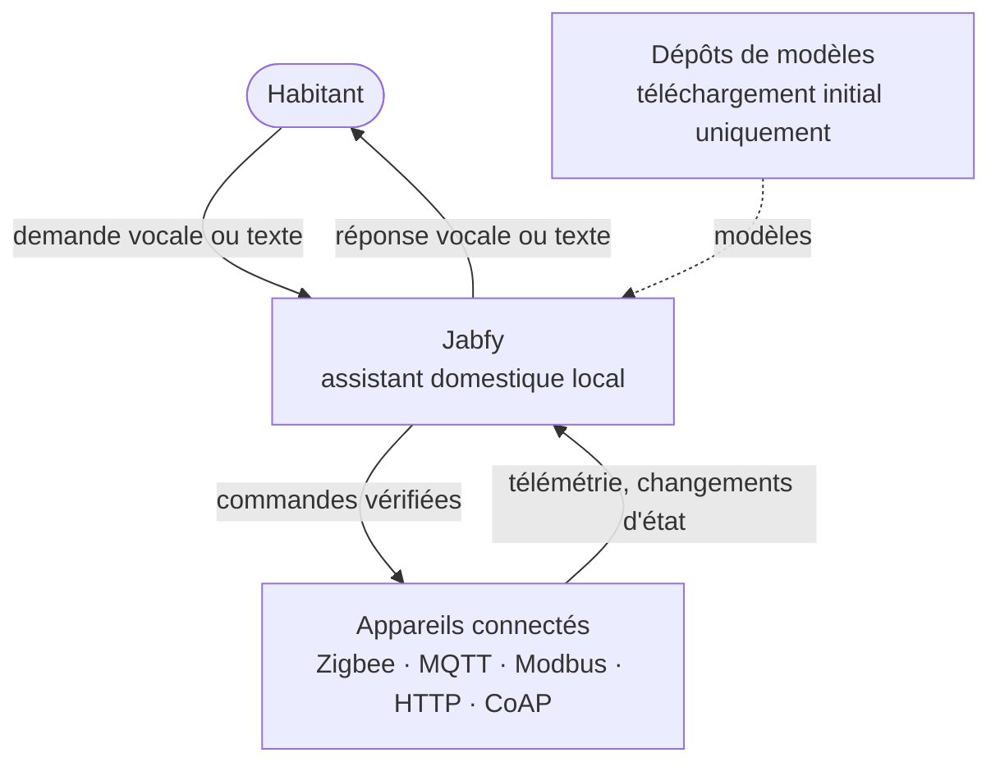
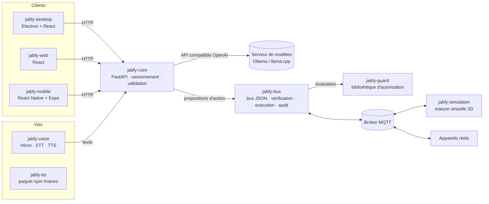
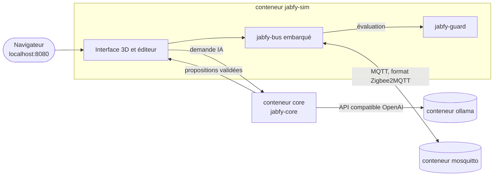
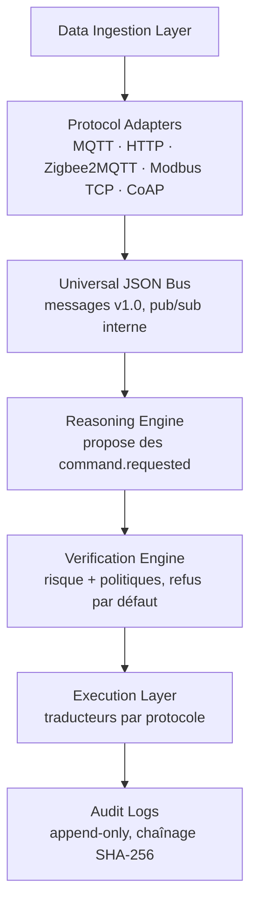
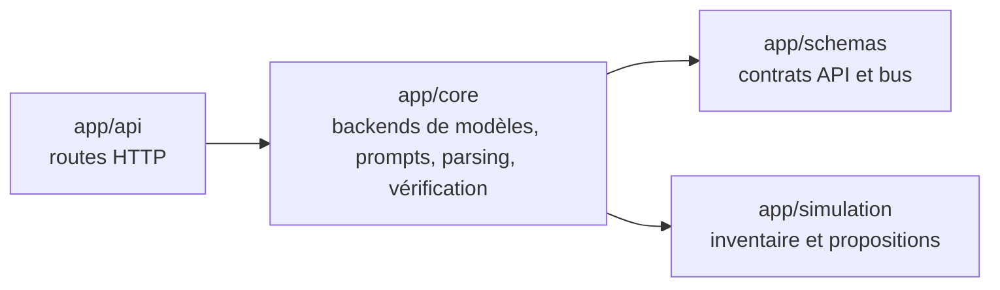

# Vue globale (C4)

Modèle [C4](https://c4model.com) : on zoome du contexte vers les conteneurs, puis vers les composants des plus gros morceaux.

## Niveau 1 — Contexte

Le seul échange avec l'extérieur est le téléchargement initial des modèles. Tout le reste reste sur le réseau local.

## Niveau 2 — Conteneurs (architecture cible)

Un bloc par repo.

[jabfy-deploy](https://github.com/jabfy-corp/jabfy-deploy) assemble ces conteneurs : il possède la topologie, les connexions, les volumes et les contrôles de santé.

## Déploiement V0.0.1

Ce que jabfy-deploy lance aujourd'hui, différent de la cible sur un point : **Bus et Guard sont embarqués dans le runtime de simulation**, et non des services séparés.

Seuls des appareils virtuels sont pilotés.

## Niveau 3 — Composants

### jabfy-bus

### jabfy-core

Le détail de chaque composant est dans [Composants](../composants/README.md).
