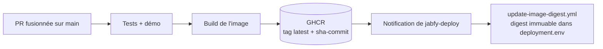
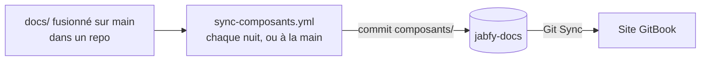

# CI/CD

## Ce qui tourne aujourd'hui

État des workflows sur `main`, au 27/10/2026.

| Repo | Intégration continue | Livraison | État |
|---|---|---|---|
| jabfy-bus | `ci.yml` : tests sur Python 3.10, 3.11 et 3.12, puis démo du pipeline | `publish-image.yml` : image sur `ghcr.io/jabfy-corp/jabfy-bus` à chaque push sur `main` | ✅ Vert |
| jabfy-core | `ci.yml` : `pytest` sur Python 3.11 | Workflow de publication d'image prêt sur la branche `core-3`, actif une fois fusionné sur `main` | ✅ Vert sur `main` |
| jabfy-deploy | `ci.yml` : validation des fichiers Compose et tests du lanceur | `update-image-digest.yml` : met à jour le digest des images déployées | ✅ Vert |
| jabfy-tts | `ci.yml` : `cargo fmt`, `clippy`, build release | `publish.yml` : publication à chaque release | ⚠️ Rouge sur les dernières PR |
| jabfy-simulation | `ci.yml` : `npm ci`, `npm run lint`, `npm run build` | — | ❌ **Toujours rouge : workflow Node copié sur un projet Python** |
| jabfy-website | `ci.yml` : lint et build Node | — | ✅ |
| jabfy-docs | `check-docs.yml` : liens internes | `sync-composants.yml` chaque nuit, puis GitBook Git Sync | ✅ Vert |
| jabfy-voice, jabfy-guard | Aucune CI sur `main` | — | ❌ |

Workflows communs, fournis par [jabfy-template](https://github.com/jabfy-corp/jabfy-template) :

| Workflow | Déclencheur | Rôle |
|---|---|---|
| `pr-validation.yml` | Pull request | Refuse une PR qui n'est liée à aucune issue (`Closes #N`) |
| `issue-labeler.yml` | Issue ouverte ou modifiée | Pose les labels selon les cases cochées dans l'issue |
| `notify-docs.yml` | Push sur `main` touchant `docs/` | Demande à jabfy-docs de resynchroniser la doc (déjà en place dans jabfy-core et jabfy-deploy) |

## Pipeline des images



L'attestation de provenance des images n'est faite que pour les repos publics : sur un repo privé, elle demande un plan GitHub payant.

## Pipeline de la documentation



Secret utilisé : `DOCS_SYNC_TOKEN` dans jabfy-docs, en lecture seule sur les repos privés (bus, simulation, deploy, website). Les repos publics sont lus sans token.

## Problèmes connus

- [ ] **jabfy-simulation** : remplacer le workflow Node par `pytest`, sinon aucune PR de ce repo n'est réellement vérifiée.
- [ ] **jabfy-voice, jabfy-guard** : aucune CI ; à ajouter dès que leurs tests existent.
- [ ] **jabfy-bus** : la CI n'installe pas FastAPI, donc ses 5 tests d'API sont sautés.
- [ ] **Secrets d'organisation** : sur le plan GitHub gratuit, ils ne sont pas accessibles aux repos privés. Les secrets de notification (`DOCS_DISPATCH_TOKEN`, `JABFY_DEPLOY_DISPATCH_TOKEN`) doivent être créés repo par repo.

## Cible

Centraliser les workflows communs dans le repo [`jabfy-corp/.github`](https://github.com/jabfy-corp/.github), sous forme de **workflows réutilisables**, que chaque repo appelle :

```yaml
jobs:
  ci:
    uses: jabfy-corp/.github/.github/workflows/python-ci.yml@main
```

Une correction faite une fois dans `.github` profite alors à tous les repos. Exemple : l'erreur de jabfy-simulation, un workflow Node copié dans un projet Python, ne pourrait plus se produire.
