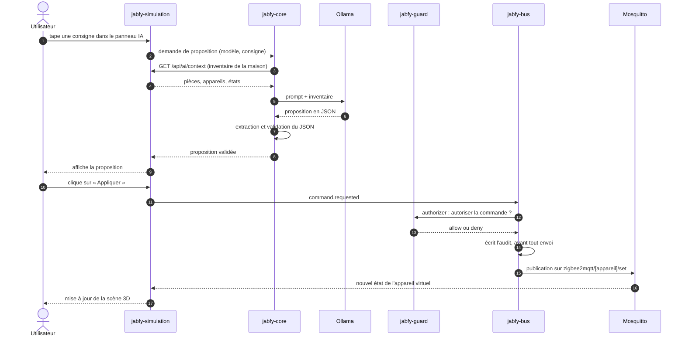
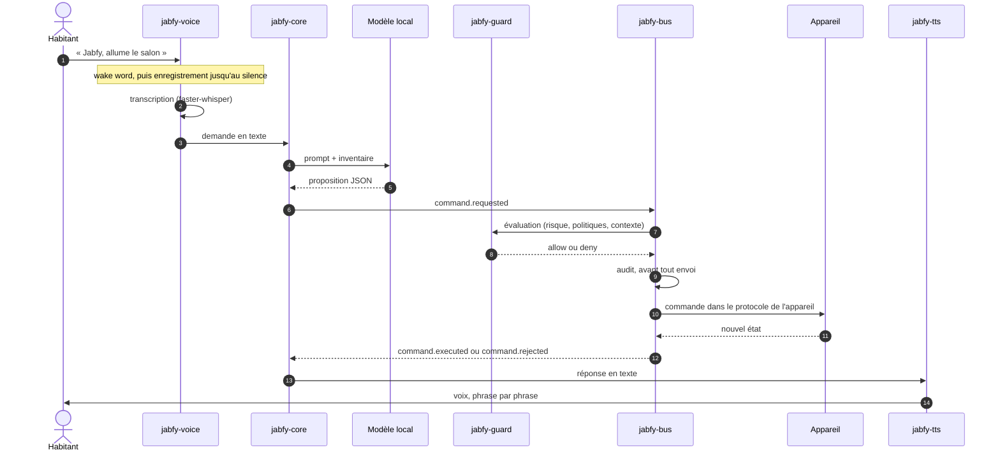

# Flux d'une demande

## Aujourd'hui (V0.0.1) : demande texte dans la maison virtuelle

Points importants :

* **aucune proposition n'est exécutée automatiquement** : l'utilisateur garde la main ;
* **les commandes manuelles** (clic sur un appareil dans la scène 3D) suivent le même chemin Guard → Bus → audit ;
* **si l'écriture de l'audit échoue, la commande n'est pas envoyée**.

## Cible : du mot d'activation à la réponse vocale

Ce qui manque pour y arriver : le wake word ([veille](../veille/etudes/wake-word.md)), le branchement de jabfy-voice sur jabfy-core, la convergence de la V0.0.1 sur `main`, et le choix de l'intégration entre la voix (Python) et jabfy-tts (Rust).

## Étapes mesurées

Chaque étape a son chronomètre, pour savoir où part le temps. Détail dans [Performance › Latence](../performance/latence.md).

| Étape                              | Composant               | Mesure             | Valeur mesurée (27/10/2026)                |
| ---------------------------------- | ----------------------- | ------------------ | ------------------------------------------ |
| Détection du wake word             | jabfy-voice             | `t_wake`           | Pas encore de wake word                    |
| Fin de parole → texte              | jabfy-voice             | `t_stt`            | À mesurer                                  |
| Demande → proposition              | jabfy-core + modèle     | `t_llm`            | 0,3 à 3,6 s selon le modèle et le matériel |
| Proposition → décision → exécution | jabfy-bus + jabfy-guard | `t_verif + t_exec` | 0,65 ms avec audit sur disque              |
| Texte → premier son                | jabfy-tts               | `t_tts`            | À mesurer                                  |
