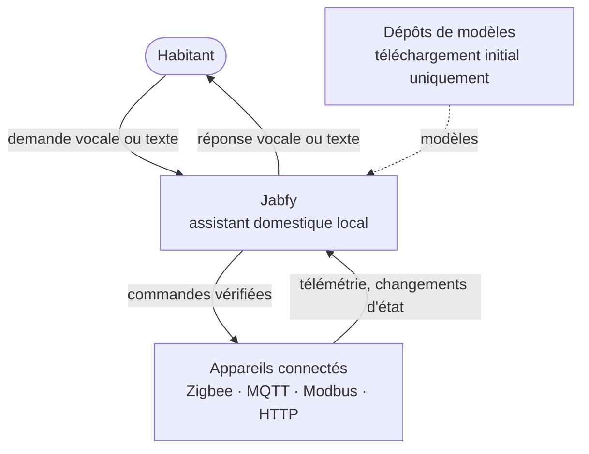
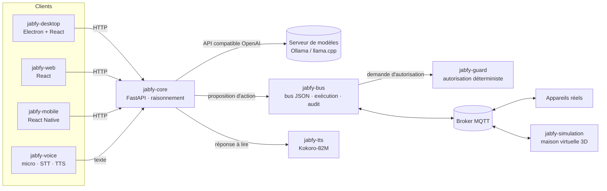
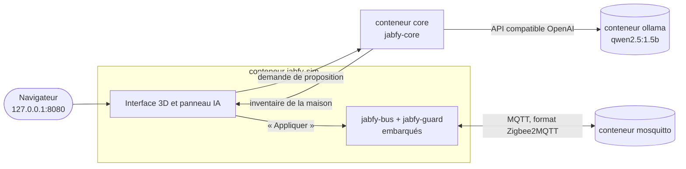
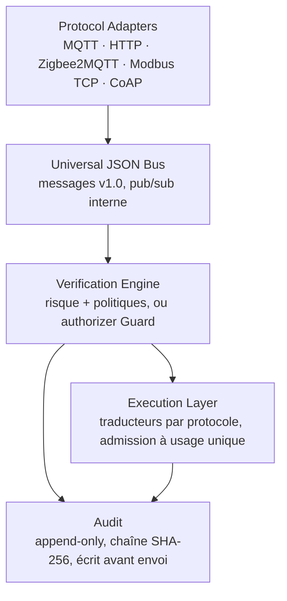
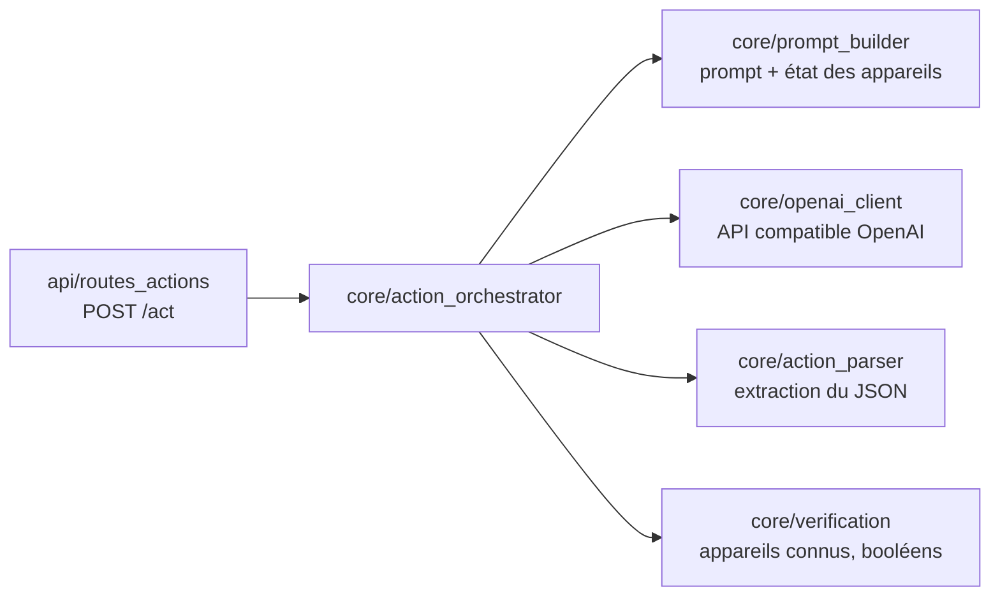
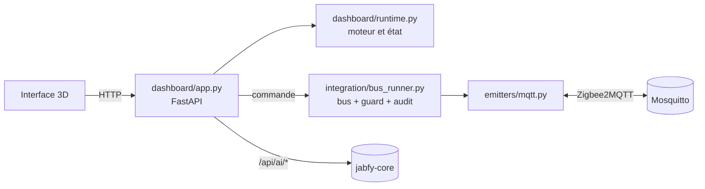

# Vue globale (C4)

Modèle [C4](https://c4model.com) : on zoome du contexte vers les conteneurs, puis vers les composants des plus gros morceaux.

## Niveau 1 — Contexte

Le seul échange avec l'extérieur est le téléchargement initial des modèles. Tout le reste se passe sur le réseau local.

## Niveau 2 — Conteneurs (architecture cible)

Un bloc par repo. Règle centrale : **l'IA propose, Guard autorise, le Bus exécute**.

| Repo | Rôle | Technologie | Doc composant |
|---|---|---|---|
| jabfy-core | Reçoit la demande, interroge le modèle, renvoie une proposition vérifiée | Python, FastAPI | ✅ |
| jabfy-bus | Traduit les protocoles en messages JSON communs, vérifie, exécute, audite | Python, bibliothèque standard | ✅ |
| jabfy-guard | Décide d'autoriser une commande : risques, politiques, refus par défaut | Python, bibliothèque | Code sur branche |
| jabfy-simulation | Maison virtuelle 3D qui parle de vrais protocoles | Python, FastAPI, Three.js | ✅ |
| jabfy-deploy | Assemble et lance la pile | Docker Compose | ✅ |
| jabfy-voice | Micro, transcription, réponse, voix | Python | ✅ (en PR) |
| jabfy-tts | Synthèse vocale locale | Rust (migration depuis TypeScript) | ✅ |
| jabfy-desktop, jabfy-web, jabfy-mobile | Interfaces utilisateur | Electron, React, React Native | Pas encore de code |

[jabfy-deploy](../composants/README.md) assemble ces conteneurs : il possède la topologie, les connexions, les volumes et les contrôles de santé.

## Ce qui tourne aujourd'hui : la V0.0.1

La V0.0.1 est une **maison virtuelle pilotée par l'IA**, lancée en une commande par jabfy-deploy. Elle diffère de la cible sur trois points :

- **Bus et Guard sont embarqués** dans le processus de la simulation, comme bibliothèques ([ADR-0006](adr/0006-bus-et-guard-embarques.md)) ;
- **la demande est tapée au clavier** dans l'interface 3D : la voix n'est pas encore branchée ;
- **rien n'est exécuté sans clic** : l'utilisateur voit la proposition et clique sur « Appliquer ».

### État de convergence vers `main`

La V0.0.1 se lance à partir de branches compatibles, listées dans la doc de jabfy-deploy. Leur fusion sur `main` est le chantier principal de la phase suivante.

| Repo | Branche V0.0.1 | Sur `main` ? |
|---|---|---|
| jabfy-bus | `bus-2-publish-container-image` | ✅ Fusionnée (PR #3 et #6) |
| jabfy-core | `core-3-publish-container-image` | ❌ `main` expose seulement `POST /act` |
| jabfy-guard | `guard-4-v001-deployment` | ❌ `main` ne contient pas encore la bibliothèque |
| jabfy-simulation | `sim-2-v001-deployment` | ❌ |
| jabfy-deploy | `deploy-1-bootstrap-container-deployment` | ❌ |

En parallèle, la branche `core-12-bus-integration` explore une autre option : **embarquer le bus dans Core** plutôt que dans la simulation. Les deux lignes doivent être réconciliées par une décision d'équipe, à consigner dans un ADR.

## Niveau 3 — Composants

### jabfy-bus

### jabfy-core (`main`)

### jabfy-simulation

Le détail de chaque composant est dans [Composants](../composants/README.md).
