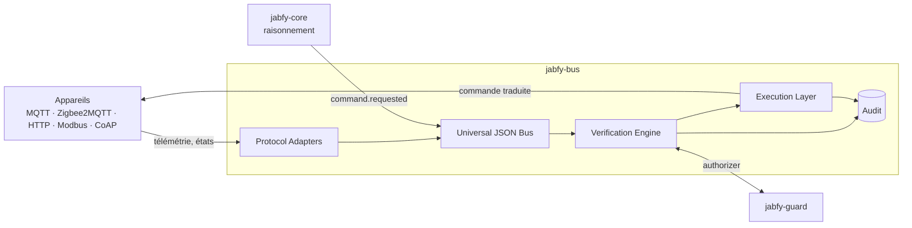

# jabfy-bus

> ⚠️ Page recopiée automatiquement depuis [jabfy-bus/docs/README.md](https://github.com/jabfy-corp/jabfy-bus/blob/main/docs/README.md). Toute modification faite ici sera écrasée : modifiez le repo d'origine.

Le bus JSON universel de Jabfy. Il traduit chaque protocole domotique (MQTT, Zigbee2MQTT, HTTP, Modbus TCP, CoAP) vers un message JSON commun, fait vérifier toute commande avant de l'exécuter, et trace chaque décision dans un journal d'audit dont toute altération se détecte.

## Rôle dans l'architecture

| Composant | Relation avec le bus |
|---|---|
| jabfy-core | Les actions qu'il propose entrent sur le bus en `command.requested`, la consigne de l'utilisateur en `user_situation`. Il ne publie jamais directement vers un appareil. |
| jabfy-guard | Décide d'autoriser ou non une commande. Il est branché comme `authorizer` du Verification Engine. |
| jabfy-simulation | Embarque le bus dans la V0.0.1 et lui fournit Guard, l'audit et le transport MQTT vers la maison virtuelle. |
| jabfy-deploy | Lance la pile V0.0.1. Le bus n'y est pas un service séparé. |
| Appareils | Parlent leur protocole natif ; seuls les adapters le connaissent. |

## Pages

| Page | Contenu |
|---|---|
| [Installation et lancement](installation.md) | Prérequis, installation, commandes, configuration, conteneur |
| [Fonctionnement interne](architecture.md) | Couches, règles, flux d'un message, modules, intégration V0.0.1 |
| [Interfaces](interfaces.md) | Messages produits et consommés, format des commandes, API Python, HTTP et WebSocket |
| [Schéma de message](message-schema.md) | Le message v1.0, champ par champ |
| [Sécurité](security.md) | Lecture/écriture, risques, policies, admission, audit |
| [Adapters](adapters.md) | Adapters existants et à venir |
| [Tests](tests.md) | Lancer les tests, ce qu'ils couvrent, CI |
| [Roadmap](roadmap.md) | Phases réalisées et à venir |

## Deux façons de l'utiliser

- **Embarqué**, comme bibliothèque Python : c'est le cas de la V0.0.1, où jabfy-simulation construit le bus et y branche Guard. Voir [Interfaces](interfaces.md).
- **Autonome**, en ligne de commande : `jabfy-bus demo` rejoue un scénario complet en simulation, `jabfy-bus serve` expose une API de consultation. Voir [Installation et lancement](installation.md).

## État actuel

Au 26/10/2026 :

- **`main`** contient la phase 1 (version 0.1.0) : pipeline complet, adapters P0, vérification, exécution, audit, simulation, API de consultation, CLI.
- **La V0.0.1** est dans la PR #6, avec une CI verte, mais n'est pas encore fusionnée : `authorizer` Guard, admission à usage unique, audit écrit avant l'envoi, type `user_situation`, origines autorisées, image conteneur.
- 96 tests unitaires, sans réseau ni matériel.

## Limites connues et TODO

- [ ] `jabfy-bus serve` lit la configuration, mais ne démarre ni les adapters ni les policies qu'elle contient, et n'enregistre aucun transport. L'API servie reste vide tant que rien ne publie sur le bus.
- [ ] La CI n'installe pas FastAPI : les 5 tests d'API (CORS, origines WebSocket) y sont sautés.
- [ ] `jabfy-bus validate` sur un fichier introuvable affiche une trace Python au lieu d'un message d'erreur.
- [ ] Pas encore de validation humaine pour les commandes `high` et `critical` : Guard peut refuser, mais personne ne confirme.
- [ ] L'adapter CoAP est un squelette, sans transport.
- [ ] Des adapters sont en cours sur des branches non fusionnées depuis juillet : `feat/home-assistant-bridge`, `feat/matter-adapter`, `feat/opcua-adapter`, `feat/ble-presence`, `feat/capability-discovery`.
- [ ] Générer la doc de référence des messages à partir de `schemas/`.

Suite du travail : [Roadmap](roadmap.md).
