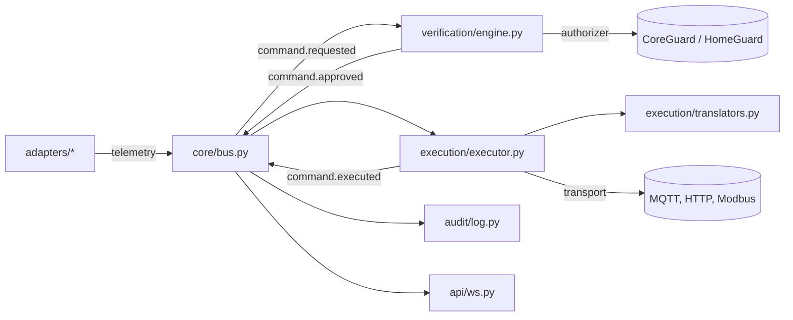

# jabfy-bus — carte des fichiers

> ⚠️ Page recopiée automatiquement depuis [jabfy-bus/docs/code/README.md](https://github.com/jabfy-corp/jabfy-bus/blob/main/docs/code/README.md). Toute modification faite ici sera écrasée : modifiez le repo d'origine.

> La bibliothèque de transport et de contrôle : enveloppe JSON commune, vérification, exécution, audit, adapters protocoles.

Tests : [tests](tests.md) · build : [build et CI](build.md)

## Schéma

## À lire d'abord

1. [jabfy_bus/core/bus.py](core-bus.md) — Le bus lui-même : `UniversalJsonBus`, publication/abonnement de `BusMessage` en mémoire.
2. [jabfy_bus/core/message.py](core-message.md) — L'enveloppe JSON commune : `BusMessage` (type, source, entité, trust, risque, `correlation_id`…).
3. [jabfy_bus/verification/engine.py](verification-engine.md) — VerificationEngine : décide `approved`/`rejected` pour chaque `command.requested`.
4. [jabfy_bus/execution/executor.py](execution-executor.md) — ExecutionLayer : exécute une commande approuvée via le transport du protocole.
5. [jabfy_bus/execution/translators.py](execution-translators.md) — Traduit une commande JSON en message protocole (ex. payload MQTT `/set`).
6. [jabfy_bus/audit/log.py](audit-log.md) — Journal d'audit chaîné par hachage : chaque message du bus y est ajouté.
7. [jabfy_bus/adapters/zigbee2mqtt/adapter.py](zigbee2mqtt-adapter.md) — Adapter Zigbee2MQTT : transforme les messages `zigbee2mqtt/<device>` en messages bus.

## Tous les fichiers

### `examples`

| fichier | rôle | statut |
|---|---|---|
| [examples/demo_pipeline.py](examples-demo-pipeline.md) | Exemple exécutable du pipeline complet du bus. | actif |

### `jabfy_bus/adapters`

| fichier | rôle | statut |
|---|---|---|
| [jabfy_bus/adapters/base.py](base.md) | `BaseAdapter` : socle commun des adapters protocolaires (émission, santé, écriture). | actif |

### `jabfy_bus/adapters/coap`

| fichier | rôle | statut |
|---|---|---|
| [jabfy_bus/adapters/coap/adapter.py](coap-adapter.md) | Squelette d'adapter CoAP, prévu pour plus tard. | squelette (phase 2) |

### `jabfy_bus/adapters/http`

| fichier | rôle | statut |
|---|---|---|
| [jabfy_bus/adapters/http/adapter.py](http-adapter.md) | Adapter HTTP par polling : lit des endpoints REST et publie leurs valeurs. | actif |
| [jabfy_bus/adapters/http/webhook.py](http-webhook.md) | Réception de webhooks HTTP entrants. | actif |

### `jabfy_bus/adapters/modbus`

| fichier | rôle | statut |
|---|---|---|
| [jabfy_bus/adapters/modbus/adapter.py](modbus-adapter.md) | Adapter Modbus : lit des registres et écrit des consignes. | actif |
| [jabfy_bus/adapters/modbus/registers.py](modbus-registers.md) | Description des registres Modbus (type, échelle, encodage). | actif |

### `jabfy_bus/adapters/mqtt`

| fichier | rôle | statut |
|---|---|---|
| [jabfy_bus/adapters/mqtt/adapter.py](mqtt-adapter.md) | Adapter MQTT générique : topics → télémétrie via des règles de mapping. | actif |
| [jabfy_bus/adapters/mqtt/mapping.py](mqtt-mapping.md) | Règles de correspondance topic MQTT → entité/valeur. | actif |

### `jabfy_bus/adapters/zigbee2mqtt`

| fichier | rôle | statut |
|---|---|---|
| [jabfy_bus/adapters/zigbee2mqtt/adapter.py](zigbee2mqtt-adapter.md) | Adapter Zigbee2MQTT : transforme les messages `zigbee2mqtt/<device>` en messages bus. | actif |
| [jabfy_bus/adapters/zigbee2mqtt/devices.py](zigbee2mqtt-devices.md) | Connaissance des modèles Zigbee2MQTT : correspondance des « exposes » vers les entités. | actif |

### `jabfy_bus/api`

| fichier | rôle | statut |
|---|---|---|
| [jabfy_bus/api/app.py](api-app.md) | API HTTP de lecture du bus (mode service autonome). | actif |
| [jabfy_bus/api/ws.py](api-ws.md) | WebSocket `/bus/events` : diffuse en direct les messages du bus. | actif |

### `jabfy_bus/audit`

| fichier | rôle | statut |
|---|---|---|
| [jabfy_bus/audit/log.py](audit-log.md) | Journal d'audit chaîné par hachage : chaque message du bus y est ajouté. | actif |

### `jabfy_bus`

| fichier | rôle | statut |
|---|---|---|
| [jabfy_bus/cli.py](cli.md) | Commande `jabfy-bus` : `demo`, `validate`, `audit-verify`, `serve`. | actif |
| [jabfy_bus/config.py](config.md) | Chargement de la config du bus (JSON, YAML si disponible). | actif |
| [jabfy_bus/logging_utils.py](logging-utils.md) | Logs JSON structurés. | actif |

### `jabfy_bus/core`

| fichier | rôle | statut |
|---|---|---|
| [jabfy_bus/core/bus.py](core-bus.md) | Le bus lui-même : `UniversalJsonBus`, publication/abonnement de `BusMessage` en mémoire. | actif |
| [jabfy_bus/core/errors.py](core-errors.md) | Exceptions du bus. | actif |
| [jabfy_bus/core/message.py](core-message.md) | L'enveloppe JSON commune : `BusMessage` (type, source, entité, trust, risque, `correlation_id`…). | actif |
| [jabfy_bus/core/registry.py](core-registry.md) | `EntityRegistry` : dernier état connu de chaque entité vue sur le bus. | actif |
| [jabfy_bus/core/types.py](core-types.md) | Énumérations du bus : types de message, niveaux de risque, niveaux de confiance. | actif |

### `jabfy_bus/execution`

| fichier | rôle | statut |
|---|---|---|
| [jabfy_bus/execution/executor.py](execution-executor.md) | ExecutionLayer : exécute une commande approuvée via le transport du protocole. | actif |
| [jabfy_bus/execution/translators.py](execution-translators.md) | Traduit une commande JSON en message protocole (ex. payload MQTT `/set`). | actif |

### `jabfy_bus/simulation`

| fichier | rôle | statut |
|---|---|---|
| [jabfy_bus/simulation/devices.py](simulation-devices.md) | Appareils simulés minimalistes internes au bus (pour ses tests et démos). | actif |
| [jabfy_bus/simulation/lab.py](simulation-lab.md) | Labo de simulation du bus : relie appareils simulés et transport. | actif |
| [jabfy_bus/simulation/scenarios.py](simulation-scenarios.md) | Scénario de démo autonome du bus : capteur de mouvement → règle → lumière. | actif |

### `jabfy_bus/verification`

| fichier | rôle | statut |
|---|---|---|
| [jabfy_bus/verification/engine.py](verification-engine.md) | VerificationEngine : décide `approved`/`rejected` pour chaque `command.requested`. | actif |
| [jabfy_bus/verification/policies.py](verification-policies.md) | Policies déclaratives du bus (domaines, actions, risque max, confiance min, fenêtre horaire). | actif |
| [jabfy_bus/verification/risk.py](verification-risk.md) | Table de risque du bus : risque de base par action et plancher par domaine. | actif |

## Hors pages

Les `__init__.py` des sous-paquets ré-exportent leurs classes (ex. `jabfy_bus.adapters.mqtt` → `MQTTAdapter`) : pas de page.
