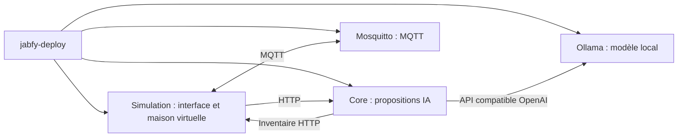

# jabfy-deploy

> ⚠️ Page recopiée automatiquement depuis [jabfy-deploy/docs/README.md](https://github.com/jabfy-corp/jabfy-deploy/blob/main/docs/README.md). Toute modification faite ici sera écrasée : modifiez le repo d'origine.

jabfy-deploy est le point d'entrée pour assembler, démarrer et arrêter Jabfy.
Il définit les services Docker, leurs connexions, leur configuration et la
persistance des données. Il ne contient ni moteur IA, ni moteur de simulation,
ni règles d'autorisation : ces responsabilités restent dans les composants.

## État documenté

Cette documentation décrit la V0.0.1 de la branche
`deploy-1-bootstrap-container-deployment` (base `4e62554`). Au 27 octobre 2026,
`main` ne contient pas encore cette stack. Il faut utiliser les branches compatibles
indiquées dans [Installation](installation.md), pas cinq clones de `main`.

Deux configurations coexistent, mais ne sont pas interchangeables :

| Configuration | Usage | État |
|---|---|---|
| `compose.local.yml` | Maison virtuelle, construite depuis les sources locales | Chemin fonctionnel V0.0.1 |
| `docker-compose.yml` + `deployment.env` | Distribution par images GHCR immuables | Configuration historique à finaliser ; digests fictifs |

## Rôle dans l'architecture

Guard est une bibliothèque Python et Bus est embarqué dans le runtime Simulation.
Il n'y a donc pas de conteneur Guard ni de second Bus dans la stack locale.
L'IA propose ; après application explicite, Guard autorise et Bus exécute sur les
appareils virtuels. Les commandes manuelles suivent aussi ce contrôle.

## Pages

- [Installation et lancement](installation.md)
- [Fonctionnement interne](fonctionnement.md)
- [Interfaces et configuration](interfaces.md)
- [Exploitation et diagnostic](exploitation.md)
- [Publication des images et de la documentation](publication.md)
- [Tests et validation](tests.md)
- [Livraison V0.0.1 : guide et historique](v0.0.1.md)

## Limites

Prototype local, sans authentification multi-utilisateur, sans pilotage de matériel
réel et sans garantie de disponibilité. Les dépendances et images amont ne sont
pas toutes figées. La configuration locale n'est pas une installation de production
à exposer sur Internet.
